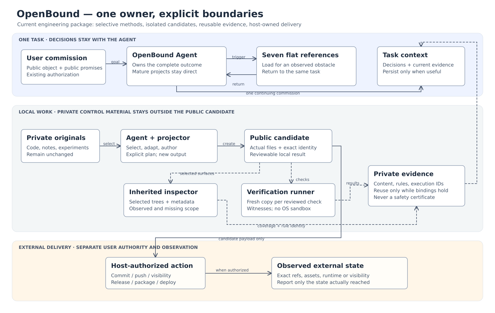

# OpenBound

English | [简体中文](README.zh-CN.md)

Turn private work into public work that people can understand, use, inspect, or build on. OpenBound is an Agent Skill with seven conditional methods and three local Python tools. It supports complete software release preparation, component extraction, research blueprints, and continued public development.

Choose the public object and its promises separately. Publishing source does not promise maintenance; a blueprint need not pretend to be executable software. Preserve mature functionality, tests, documentation, licenses, and CI, and address concrete gaps.



See the [editable architecture and exports](docs/architecture.md).

## Get started

```bash
git clone https://github.com/IndelibleVivi/openbound.git
cd openbound
python3 -B tools/validate.py
```

The intended canonical repository is `IndelibleVivi/openbound`; publication status is recorded in [current state](docs/current-state.md). The complete installation unit is [skills/openbound](skills/openbound/SKILL.md). See [installation and migration](docs/migration.md) for the installer command using `--repo IndelibleVivi/openbound --path skills/openbound`.

In a compatible Agent Skills host, request:

```text
Use $openbound to prepare this completed private project as a complete public candidate.
Preserve its behavior, tests, and documentation. Address private configuration and the
history that will actually be exposed. Verify the candidate and complete authorized delivery.
```

Methods load when a concrete uncertainty requires them. Ordinary development or a small public README repair without a private boundary stays in the normal workflow. Optional editing and engineering methods are not runtime dependencies.

## Local tools

| Tool | Purpose | Evidence limit |
| --- | --- | --- |
| `project_candidate.py` | Explicit selection and exact replacements into a new isolated candidate; receipts and recovery | Protects source and refuses drift; does not judge meaning or grant permission |
| `inspect_public_candidate.py` | Selected worktree, index, ref, history and metadata inspection | Reports rules and coverage gaps; LFS pointers do not cover payloads; no safety certification |
| `verify_public_work.py` | Reviewed checks in disposable copies, mechanism witnesses and reusable evidence | Minimal environment and bounded output; no OS or network sandbox |

```bash
python3 skills/openbound/scripts/project_candidate.py inventory --source /absolute/source
```

Inventory proposes tracked files for review. Read the [tool contracts](skills/openbound/references/continuation-and-tools.md) and [examples](examples/) before materializing or executing checks. Examples do not authorize reducing a complete project's scope.

## Development and evidence

Python 3.10+, Git and POSIX are required. Windows is unsupported. Tools refuse symlinks, special files and symlink ancestors; resolve macOS temporary aliases to real paths. The provider-neutral gate above checks structure and links, all unittest scenarios, and three CLI entry points from a relocated complete Skill. Optional authoring validation: `skill-validate skills/openbound`.

[Validation](docs/validation.md) distinguishes 116 locally observed tests, deterministic scenarios, historical Agent reports and unverified host activation. Tests do not establish reader comprehension or real research effects.

For a source ZIP, review and stage the intended files, then run `python3 -B tools/package.py --output /absolute/outside-repository/openbound-source.zip`. Packaging selects tracked allowed files, preserves modes and writes the manifest only inside the ZIP. After extraction run `python3 -B tools/check_package.py --manifest`.

## Boundaries and rights

Keep original private material, selection plans, reports and receipts private. Scanning cannot establish all semantic, binary, media, LFS, cumulative-disclosure or third-party-rights properties. Executing project checks requires appropriate authorization and host isolation. External contributions are untrusted input.

**No general public license is granted.** Source visibility is not an OSI open-source claim. MIT notices in synthetic fixtures apply only to those fixtures. Read [license status](LICENSE-STATUS.md) and [provenance](PROVENANCE.md).

OpenBound is independently maintained here; migration does not promise automatic synchronization with its earlier integration source.

- [Engineering design](ENGINEERING_DESIGN.md): ownership, protocols, recovery and limits.
- [Acceptance](evals/ACCEPTANCE.md): deterministic checks, Agent behavior and host activation.
- [Contributor contract](AGENTS.md): canonical paths, privacy and verification.
