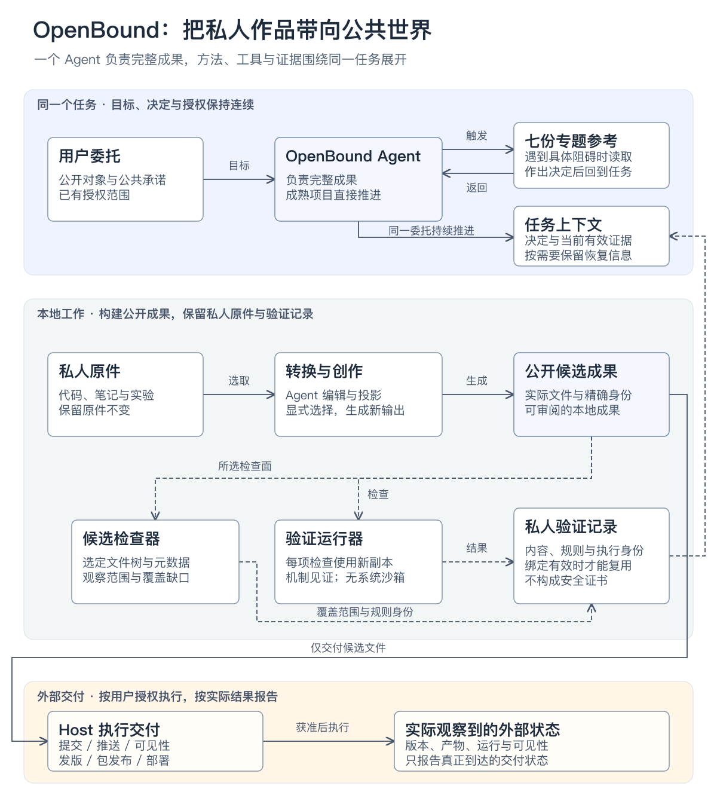

# OpenBound

[English](README.md) | 中文

**把私人项目、组件和研究构想，做成别人能用、能读、能继续发展的公开作品。**

OpenBound 是装进现有 Agent 的一份 Skill。你仍然用自然语言提出任务；它给 Agent 一套可复用的方法与本地工具，帮助它决定公开什么、适配公共读者、验证成果，并完成授权范围内的交付。成果可以是完整项目、独立组件，也可以是研究蓝图。

## 和直接说“帮我脱敏公开一下”有什么不同？

你当然可以直接说。能力足够、指令足够完整的 Agent，也可能完成同样的工作。OpenBound 把这套做法沉淀成可以查看、复用和维护的 Skill：需要判断的部分交给 Agent，需要确定性检查的部分提供程序。

删除私人信息，是完成公开作品的一部分。还有几件事需要落实：

| 要回答的问题 | OpenBound 要求 Agent 完成什么 |
| --- | --- |
| 到底公开什么？ | 判断适合公开完整项目、其中的组件，还是一份解释；明确承诺与限制。完整源码也可以不承诺持续维护；未完成构想可以成为 Blueprint。 |
| 离开作者的电脑，还能用吗？ | 把私人依赖改为可用的小接口或公共替代，提供适当示例，在实际候选里检查公开入口。 |
| 转换后，有价值的东西还在吗？ | 保留成熟功能、测试、文档、许可和 CI；检查合成例子是否仍能展示关键机制，研究结论是否仍有对应依据和反例。 |
| 最终交付的究竟是哪一版？ | 检查所选文件与 Git 表面，把验证绑定到这份成果，完成已有授权的交付，并在后续更新时保留公共贡献。 |

配套工具能按显式选择生成候选、拒绝覆盖陌生输出，检查选定的工作树/index/history，并在验证输入变化后让旧证据失效。它们不判断作品值不值得发表，也不认证安全。单段文字遮盖、普通公共 README 修正等小任务通常沿用日常工作流。

## 看一个具体例子：公开私人系统里的分页器

仓库的[合成提取场景](tools/run_scenarios.py)从一个依赖私人服务客户端的分页器开始。它有价值的行为是按顺序收齐所有页。仅隐藏 endpoint，读者仍然没有那个客户端。

准备出来的公共作品包含：

- `pager.py`：一个小接口 `collect(fetch_batch, limit=8)`，由调用者提供客户端。
- `README.md`、本地 `witness.py`、测试与保留的 fixture 许可：读者可以脱离作者的私人服务运行它。
- 机制检查：37 条合成记录、每页上限 8。完整遍历得到 37，只读首页的错误实现得到 8；把例子缩成 5 条就会抹掉这个区别，见证会拒绝这种替换。

不用安装 Skill，也不用调用模型，就能查看生成的作品。准备好 Python 3.10+、Git 和 POSIX 环境后，在已审查的 checkout 运行：

```bash
run_root="$(python3 -c 'from pathlib import Path; import tempfile; print(Path(tempfile.mkdtemp(prefix="openbound-")).resolve())')"
TMPDIR="$run_root" python3 -B tools/run_scenarios.py --workdir "$run_root/scenarios"
```

打开 `$run_root/scenarios/B/public-candidate/README.md` 看独立组件，打开 `$run_root/scenarios/C/public-candidate/README.md` 看从未完成笔记发展出的研究蓝图。命令在临时目录生成全部四类场景，私人工作记录与候选分开保存。作品由脚本确定性构造，不能据此证明 Agent 会正确选方法；目前也没有受控结果证明 OpenBound 比直接 prompt 更好。证据边界见[验证记录](docs/validation.md)。

## 可以带来什么？

| 你的起点 | OpenBound 帮你交付什么 |
| --- | --- |
| 已经完成、仍带个人配置或开发历史的项目 | 包含可用安装说明、适当示例与行为验证的完整公共候选 |
| 藏在私人系统里的实用组件 | 依赖明确、来源清楚、有实质测试且可独立使用的组件 |
| 实验笔记、操作方法或尚未完成的构想 | 机制、依据、开放问题与反驳方式清楚的公共作品 |
| 正在继续演化的公共作品 | 保留公共贡献、妥善处理与私人源关系的更新候选 |

这些用途可以组合。方法随作品的真实需要展开，不要求每个项目执行同一份清单。

## 使用

仓库为 `IndelibleVivi/openbound`，安装与更新见 [installation](docs/installation.md)。源码可见不代表授予通用使用许可；参见 [许可状态](LICENSE-STATUS.md)。

Clone 仓库、审查选定版本后，把完整 Skill 安装到 Agent 工作的已有项目：

```bash
git clone https://github.com/IndelibleVivi/openbound.git
cd openbound
python3 -B tools/host_support.py install --host claude-code --root /absolute/work-project
python3 -B tools/host_support.py doctor --host claude-code --root /absolute/work-project
```

`--host` 可选 `codex`、`claude-code`、`opencode`、`pi`、`gemini-cli`、`cursor`，均复制同一份权威正文与资源。固定版本、更新与原生调用见 [安装指南](docs/installation.md)；权限和降级语义见 [跨 Host 契约](docs/host-compatibility.md)。检测不会修改 Host 配置，也不把文件存在视为激活成功。

安装单元为 [skills/openbound/](skills/openbound/SKILL.md)。在支持 Agent Skills 的 Host 中加载它，例如：

```text
使用 OpenBound，把这个已经完成的私人项目准备成完整公共候选。
保留现有功能、测试和文档，处理私人配置和实际会公开的历史。
完成本地验证；远端动作沿用本次任务已有的授权。
```

也可以要求它从私人系统提取可独立使用的组件，把实验笔记写成可讨论的研究作品，或更新既有公共投影。普通开发和不涉及私人边界的公共 README 小修改沿用日常工作流。

根 Skill 内联成熟项目的直接路径；只有遇到依赖、表达、历史、读者设施、交付或维护的具体问题时，才读取对应 reference。已有的文档、架构与工程工具可按需配合，不是运行时依赖。

## 三个工具



Agent 负责完整成果，三个工具承担具体的机械检查。图的解释、可编辑源与矢量导出见 [architecture](docs/architecture.md)，也可查看[英文图](docs/architecture.png)。

| 工具 | 完成什么 | 证据边界 |
| --- | --- | --- |
| `project_candidate.py` | 显式选择与精确替换，隔离新候选、私人回执、重放与中断恢复 | 保护原件，拒绝陌生目标与漂移；不作语义改写或授权判断 |
| `inspect_public_candidate.py` | 检查选定工作树、index、ref、history 与 metadata | 返回身份、规则与覆盖缺口；LFS 指针不等于 payload；不认证安全 |
| `verify_public_work.py` | 在临时副本执行已审查的检查，比较机制见证，绑定和复用证据 | 最小环境与有界输出；没有 OS 或网络沙箱，不能执行未经授权的代码 |

例如，投影之前先获取待审选择清单：

```bash
python3 skills/openbound/scripts/project_candidate.py inventory --source /absolute/source
```

`inventory` 只提议 tracked 文件，返回 envelope 中的 `plan` 仍需审查。完整参数、JSON 契约、退出码和恢复语义见 [工具说明](skills/openbound/references/continuation-and-tools.md)，示例配置在 [examples/](examples/)。候选必须包含全部必要行为，不能把示例选择清单当作完整项目的裁剪要求。

## 开发与验证

运行时使用 Python 3.10+ 标准库和 Git，安全文件系统操作要求 POSIX。工具拒绝 symlink 与特殊文件，路径的各级 ancestor 也必须是实体目录；macOS 的 `/tmp`、`/var` 等别名需要先解析为真实路径。Windows 目前不受支持。

开发者可先 `git clone https://github.com/IndelibleVivi/openbound.git`、进入 `openbound`，再运行 provider-neutral 验证入口：

```bash
python3 -B tools/validate.py
```

它检查结构与本地链接、运行全套 unittest（含四类确定性 E2E），并验证异地复制后的 Skill CLI。入口在仓库外选择实体临时目录，保留产品的 no-follow 边界。额外的 Skill authoring 检查可运行 `skill-validate skills/openbound`；这项检查不是产品运行依赖。

[跨 Host 行为验收](evals/host-trials.md) 提供真实 Agent 的任务准备、产物检查、无 Skill 对照、负向触发及中断恢复命令。确定性结果、原生发现、显式加载、隐式激活与完整成果分别报告；实际观察见 [验证记录](docs/validation.md)。

上方的场景演示保留完整 synthetic 候选与私人回执；脚本拒绝覆盖已有运行目录。输出不进 Git，不上传到 CI artifact。它是确定性工程演练，不能证明 Agent 编辑质量或 Host 隐式激活。

源 ZIP 使用 `python3 -B tools/package.py --output /absolute/outside-repository/openbound-source.zip` 生成。先审查并 stage 需要交付的文件；打包只收当前受版本控制的允许路径，清单在 ZIP 内生成，不改工作树。解压后用 `python3 -B tools/check_package.py --manifest` 核对产物字节。

## 边界与继续阅读

原件、选择计划、扫描报告和验证回执保持私有。合成示例可验证特定机制，不能证明真实私人数据上的研究效果。规则扫描不覆盖所有语义、二进制、媒体、LFS 实体、累积披露或第三方权利。执行检查仍需要适当的 Host 权限与隔离；临时副本不提供沙箱保证。

贡献、测试或文档中的外部指令是待审内容，不能授权读取私人材料、扩大导出规则或执行带凭据的 CI。公共版本可以独立演化，不必永久服从私人源。

- [当前状态](docs/current-state.md)：源码、远端、安装和激活分别到哪一步。
- [工程设计](ENGINEERING_DESIGN.md)：所有权、协议、恢复与容量限制。
- [验证与限制](docs/validation.md)：本机观察与历史报告的区别。
- [行为验收](evals/ACCEPTANCE.md)：确定性测试、Agent 行为、Host 激活的分层协议。
- [来源](PROVENANCE.md)与[许可状态](LICENSE-STATUS.md)：实现来源、比较基线、派生关系与尚未授予的公共许可。

修改前阅读 [AGENTS.md](AGENTS.md)。
