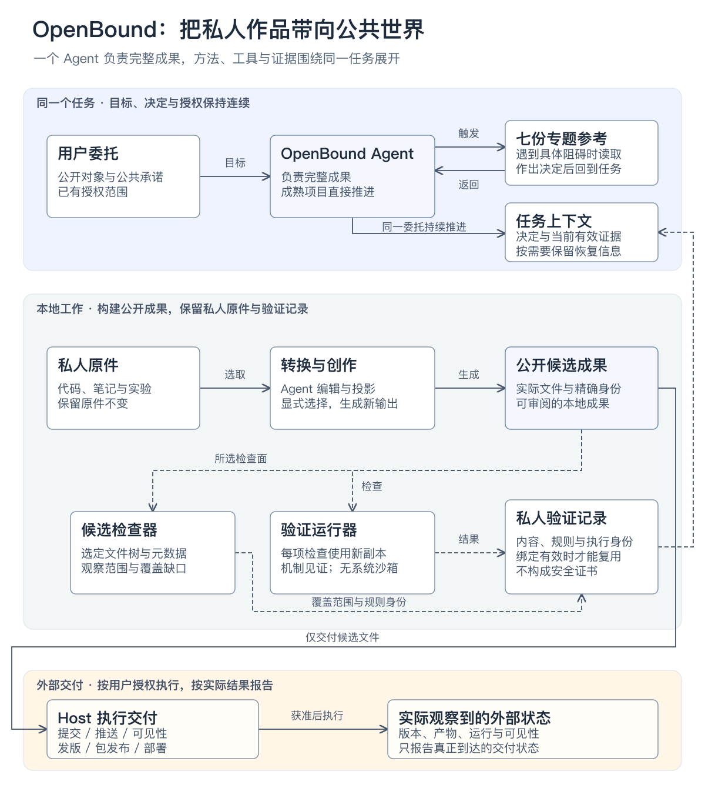

# 当前架构：所有权、候选与证据边界

[查看中文大图](architecture.zh-CN.svg) · [English diagram](architecture.png)

这张图回答：谁负责完整成果、哪些材料进入候选、什么证据可以复用、什么动作需要 Host 的实际授权与观察？

顶部是任务控制关系。OpenBound 持有完整委托；references 因具体阻碍被读取，结束后回到同一任务。持久化上下文只是恢复手段，普通任务不必创建额外文件。

中部是当前已实现的本地工具与数据。私人材料经过 Agent 编辑和显式投影，形成有身份的公共候选。检查器观察选择的文件和 Git 表面；验证工具在临时副本执行已审查的检查。回执始终是私人控制材料，绑定内容、规则与执行输入，不能成为安全或授权证书。虚线表示证据观察/返回，实线表示任务控制或候选数据流；节点文字也明确区分，颜色不是唯一编码。

底部属于 Host。实际用户授权决定提交、push、visibility、Release、包发布和部署；本地工具不授予这些权限，也不自动执行这些外部动作。已观察外部状态与本地准备是不同的完成声明。

## 编辑和复现

- [architecture-model.json](architecture-model.json)：共享节点、关系、证据与英文布局；`translations.zh-CN` 保存中文文字和对应布局。

| 版本 | 可编辑图 | 矢量图 | README 图片 |
| --- | --- | --- | --- |
| 中文 | [Excalidraw](architecture.zh-CN.excalidraw) | [SVG](architecture.zh-CN.svg) | [PNG](architecture.zh-CN.png) |
| English | [Excalidraw](architecture.excalidraw) | [SVG](architecture.svg) | [PNG](architecture.png) |

运行 `python3 -B tools/render_architecture.py` 同时生成两版 SVG 和 Excalidraw，不需要第三方 Python 依赖。PNG 再由可信本地 SVG 渲染器导出；本次使用 Sharp/libvips，并实际检查全尺寸、中文 900px 宽度及灰度 PNG。

中文使用独立排版与较大字号，两版保留相同节点、边、证据状态和授权边界。更新共享结构时同时更新翻译与布局，重新导出两版全部文件；只改文字或字体时也要检查其实际换行和边界。SVG 保留文字、语言标记与无障碍说明，Excalidraw 保留原生形状和已绑定的连接器。

原生 Excalidraw Host 导入交互尚未作为命名 Host 验收。结构检查与本地 PNG 检查不代表已观察到宿主导入后的效果。

图中的 implemented 表示交付源码存在且相应工具有本地测试，不代表所有真实项目或 Host 的运行保证。图不引入新的进程、服务、授权代理或固定流水线。
